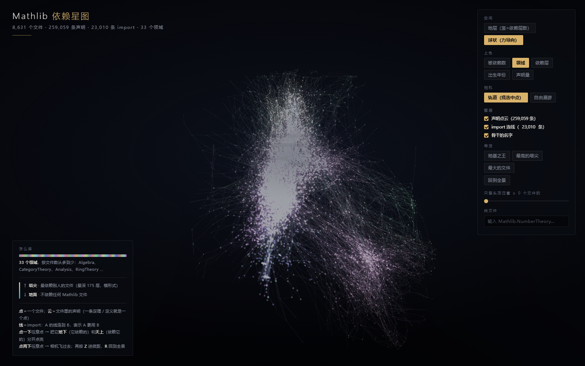

# Mathlib Dependency Star Map

**Live demo → https://hobbit18.github.io/mathlib-star-map/**

An interactive 3D map of [Mathlib](https://github.com/leanprover-community/mathlib4) — the mathematics library written for the Lean proof assistant. Every point is a file, every line is an `import`, and clicking a file splits the entire library into what it stands on and what stands on it.



No server, no build step, no network. `index.html` is self-contained — three.js and the data ship with it. Open it directly, or use the live link above.

---

## The data

Mathlib as of commit `e91b1280` (2026-10-15):

| | |
|---|---|
| `.lean` files | **8,631** |
| declarations (definitions + theorems) | **259,059** |
| distinct `import` relationships | **23,010** |
| dependency layers (longest import chain) | **176** (0–175) |
| subject areas | **33** |

## What you are looking at

| Visual | Meaning |
|---|---|
| A large dot | One `.lean` file |
| The cloud around it | The declarations inside that file — 259,059 points in total |
| A line | One `import`: from the file that *uses* to the file that is *used* |
| Vertical axis (Strata mode) | Dependency depth: 0 = imports nothing from Mathlib, 175 = deepest in the library |
| Dot size | Hybrid of the file's own weight (declaration count) and the weight it supports (how many files depend on it) |

## Three ways to look

**Colour** (top right) — default is *dependents*, i.e. how many files sit on top of this one:

- **bright gold** = many files are built on it (bedrock)
- **deep blue** = almost nothing uses it (leaf)

Four other colourings: **area** (33 subject areas), **depth** (how close to the ground), **birth quarter** (2021–2026, 22 quarters), **declarations** (how much mathematics is in the file).

**Space** — two layouts:

- **Strata**: the vertical axis is dependency depth. This one carries meaning; you can see what is stacked on what.
- **Ball**: a 3D force-directed layout. Geometrically meaningless, but it shows which files cluster together.

**Click any point** — this is the point of the whole thing:

- **Teal** = what lies *beneath* it: everything it imports, directly or transitively (its foundation)
- **Orange** = what sits *above* it: everything that imports it, directly or transitively
- The right-hand panel gives exact counts

For example, click the bright gold sphere at the very bottom — `Mathlib.Tactic.Linter.DirectoryDependency`, 460 lines, 20 declarations — and it will tell you that **8,629 files stand on it**: 99.98% of the library.

Mathlib's foundation is not mathematics. It is Lean's linters and metaprogramming.

## Controls

| Input | Effect |
|---|---|
| Left-drag | Rotate |
| Wheel | Zoom |
| Right-drag | Pan |
| Camera: **Orbit** (default) | The camera is tethered to the selected point and can only circle it |
| Camera: **Free roam** | Camera and target move together — `W A S D` to move, `E` / `Q` for up/down, hold `Shift` to accelerate, drag to look around, wheel to dolly. Speed adapts to distance (fine control up close, fast across the whole map) and keystrokes are ignored while typing in the search box |
| Hover | Tooltip: file name, area, declaration count |
| Click | Select: beneath and above light up separately |
| `Esc` | Clear selection |
| **Guide** buttons | Jump to the *king of bedrock* (most depended-upon), the *tallest spire* (deepest depth), or the *largest file* (most declarations) |
| **Hide nodes with < N dependents** | Genuinely hides points below the threshold, along with their edges — raise it and only the skeleton remains. The current selection is exempt |
| **Backbone labels** | About 50 labels: the 20 most depended-upon files plus the largest file in each area. Labels keep a constant screen size; short names that collide (e.g. two `Basic`) fall back to a three-part name |
| Search box | Type `Mathlib.NumberTheory` and jump straight there |

## URL parameters

Useful for screenshots and scripted demos:

```
index.html?nointro                          skip the intro overlay
index.html?labels=1                         show backbone labels
index.html?color=area                       preset colouring: area|sky|depth|birth|decls
index.html?space=ball                       preset layout: cone|ball
index.html?thr=1500                         preset threshold
index.html?sel=Mathlib.CategoryTheory.Abelian.Projective.Dimension
                                            preselect and fly to (exact match, then prefix, then substring)
index.html?nocloud=1&noedges=1              hide the point cloud / the edges
index.html?free=1                           start in free-roam camera mode
index.html?sel=X&micro=1                    select X and zoom straight to micro range
index.html?guide=1                          open the narrow-screen "how to read" panel
```

### For headless screenshots

```
index.html?pdb=1                enable preserveDrawingBuffer
```

Without it, headless Edge **frequently captures a blank WebGL canvas**, because the back buffer has already been cleared by the time the screenshot is taken — you get the UI panels over an empty background. Measured on the same file with the same command: 193,783 bytes blank versus 1,520,212 bytes with it. Do not enable it for normal browsing; the cost is only paid when `?pdb=1` is present.

### For self-testing and regression

These write state into a hidden `#dbg` element that `--dump-dom` can read back, so no human has to look at anything:

```
index.html?dbg=1                each frame writes camera position, cut radius, visible edge count and shader-injection status into #dbg
index.html?free=1&walk=2000     simulate holding W for 2000 frames, to verify movement
index.html?nofade=1             control switch: disable distance fade on edges (for A/B proof that it works)
```

Measured (raw `--dump-dom` readback):

| Scene | Camera to origin | Cut radius | Visible edges |
|---|---|---|---|
| Overview (default) | 293.2 | 535 | 23010 / 23010 (all of them) |
| Flying to the king of bedrock | 153 | 115 | 2029 / 23010 |
| Micro range on the tallest spire | 118 | 70 | 593 / 23010 |

A/B pixel evidence: at micro range, fade-on and `nofade=1` render **different** PNGs (543,799 vs 557,220 bytes), proving the fade reaches the framebuffer. Parked at the same distant position they are **byte-identical** (`sha 8FCDC280…`), proving the effect only engages close up and nothing in the overview was disturbed.

`visibleEdges` in `#dbg` is an upper bound — edges whose midpoint falls inside the cut radius, not excluding those dimmed by the threshold slider. At `thr=8000` it still reports 23010. It is a fade-radius check, not a count of what is actually drawn.

## Narrow screens (≤900px wide)

On a wide screen the "how to read this" panel sits permanently in the bottom-left. On a narrow screen it competes with everything else, so it becomes **click-to-open**: a "怎么读 / Guide" button appears at the top left and opens a full-screen reading panel, while the control console and detail panel step aside. Close it and they return.

Measured against the real DOM at three widths (reading `getBoundingClientRect()` to detect overlap):

| Viewport | "Guide" initially | After opening | Overlaps |
|---|---|---|---|
| 504×837 (phone) | hidden | fills `10,104–494,827` | none (console is `visibility:hidden`) |
| 790×1085 (tablet) | hidden | fills `10,104–780,1075` | none |
| 1570×905 (desktop) | **always visible** `34,542–364,877` | button does not exist (`display:none`) | none |

Desktop regression: after the CSS change, a 1600×1000 render is **byte-identical** to the render before it (`sha 07089016CF72334D…`), so the whole narrow-screen change is invisible on wide screens.

## Four fixes that only matter when you fly in

The overview exists to be taken in at a glance, but of course you want to fly into it. Everything that was fine from a distance fell apart up close, so four things were adjusted — **none of which affect the overview**:

| Problem | Symptom | Fix |
|---|---|---|
| Point cloud rendered as squares | Up close every declaration draws as a grey block tens of pixels wide, tiling into a mosaic | A 64px radial-gradient canvas texture on the `PointsMaterial` |
| Points far too large | With `sizeAttenuation`, a 0.78 world-unit point fills 85px of screen at distance 12 | Per frame: `size = clamp(camD * 0.011, 0.20, 0.90)` |
| Distant labels | Labels are constant screen size, so a label 200 units away is just as large and smears into a row of grey blocks | Do not draw beyond 280 units; fade out between 200 and 280 |
| Long edges become white haze | Edges crossing the whole scene are a wash of white when you are close to them | Each segment stores its midpoint `aMid`; `onBeforeCompile` injects `vColor *= 1.0 - smoothstep(...)` into the `basic` vertex shader, fading the whole segment past the cut radius; `cut = max(70, (camera-to-origin - 115) * 3.0)` |

## Files

| File | Contents |
|---|---|
| `index.html` | The demo itself (single file, 1026 lines / 42.8 KB) |
| `vendor/three.min.js` | three.js r128 (MIT), vendored so it works offline |
| `vendor/OrbitControls.js` | Official orbit controls (classic script build, so `file://` works) |
| `data.js` | 1.14 MB (1,142,997 bytes) — `window.MLDATA`: coordinates, degree, depth, area and birth quarter for all 8,631 files, plus 23,010 edges |
| `build_demo_data.py` | Builds `data.js` from the TSVs in `research/mathlib-map/` (deduplicates edges, cycle-safe) |
| `layout3d.py` | 3D force-directed layout, producing `pos3d_force.tsv` for Ball mode |
| `pos3d_force.tsv` | The 3D coordinates (8,632 lines = header + 8,631 files) |

**Source of the data**: a `git clone --depth 1` of `mathlib4` at commit `e91b1280`, 2026-10-15.

## Honest caveats

1. **The 259,059 points are deterministically jittered in the browser** (`mulberry32`, seed 20261017); they are not real declaration coordinates — Lean does not emit such a thing. The **count** is real; the **position** is a stand-in for "belongs to this file". Their job is to make a file's weight visible.
2. File coordinates come from a 2D layout of the dependency graph. Their **positions are arranged to look good, not measured**. What is actually data: dot brightness, dot size, vertical height, and both endpoints of every line.
3. "Above / beneath" is the **transitive closure of file-level `import`**, not references inside proofs. Whether Lemma A uses Lemma B requires reading the proof body, which is not computed here. So the numbers describe *how wide a file's foundation is*, not *how many prior theorems its proof used*.
4. "Birth quarter" = the quarter in which the file **first appeared in mathlib4** (computed by diffing quarterly snapshots from the GitHub API), not when the mathematics was discovered. The library only spans 2021-07 to 2026-10. A further 41 files are newer than the last snapshot and fall into an "after" bucket.
5. Edge count: `edges.tsv` has 23,084 rows, of which 74 are exact duplicate `(src,dst)` pairs (the same pair written as two `import` lines); **self-loops are 0**. `build_demo_data.py` deduplicates, so the 23,010 in the demo are distinct import relationships. Without deduplication, "dependents: files that import it directly" over-counts.
6. Only about 50 files are labelled, not all 8,631 — labelling everything turns the screen to mush.

## Independent review (2026-10-17)

After the demo was finished it was handed to an **independent subagent** to verify. It was read-only, made no changes, and recomputed everything itself in `%TEMP%`. It independently recomputed the transitive closure of all 8,631 nodes and concluded:

- **Core semantics are correct**: "beneath" = what it imports (teal), "above" = what imports it (orange), compared node by node against `ground` / `sky` with **0 mismatches**; `depth` versus "longest path to a sink" also **0 mismatches**.
- **259,059 is a real number**: `sum(decls) === decls_total`, and each declaration produces exactly one deterministic point.
- It also found 11 problems, **all of which have been fixed**, in the order it prioritised them:

| # | Problem | Fix |
|---|---|---|
| 1 | **The declaration cloud did not follow the layout switch**: `dpos` was computed from cone coordinates at init only, so after switching to Ball, 259,059 points stayed inside the cone (median offset 88.5 units) and selection highlights landed on empty space | Store a per-point jitter offset `doff` relative to its own file, and set `dpos = P + doff` with `position.needsUpdate` in `refresh()` |
| 2 | **The three segments of the info bar did not add up to 100%**: `tot` counted `ground` twice (`anc.size === ground`), so the green bar filled only half and orange was invisible | `tot = anc.size + 1 + desc.size` |
| 3 | 33 areas but only 22 hues, so the last 11 collided with the first 11 | 34 hues spread by the golden angle |
| 4 | The legend claimed "8592 files stand on those linters" — 8592 is actually `Mathlib.Lean.Environment`, not a linter | Corrected to 8629 / `Linter.DirectoryDependency` |
| 5 | The README claimed `edges.tsv` had "a few self-loops" — there are none; and the DFS in `build_demo_data.py` had no cycle guard, so a real cycle would have **hung** | Deduplicate edges (23,084 → 23,010); add an `onstack` guard to the DFS; correct the README |
| 6 | `?sel=` was documented as prefix matching but implemented as substring matching, and `decodeURIComponent` throws on a malformed `%` | Three-level fallback (exact → prefix → substring) inside `try/catch` |
| 7 | The threshold slider said "keep only…" but only **dimmed**; no point or edge was actually removed | Genuinely hide (black under additive blending + zero size + black edges) |
| 8 | Colliding short label names (two `Basic`, two `Ring.Defs`) | Colliding names fall back to a three-part name, then to a numeric suffix |
| 9 | Several README numbers were wrong (line count, MB, `pos3d_force.tsv` rows, "five years") | Each replaced with a measured value |
| 10 | The custom `ShaderMaterial` lacked `#include <encodings_fragment>`, so its output encoding disagreed with the built-in materials and the same colour looked different in two places | Added the include |
| 11 | Dead code (`declStart`, `AREA_COL`, an unused `s`); `indeg` inflated by duplicate edges | Removed; `indeg` became accurate once edges were deduplicated |

The reviewer also confirmed several things that are **not** bugs: `ShaderMaterial{vertexColors:true}` does compile in r128, every API used exists in r128, there are no leftover `axisLabels` references, picking and drag detection are correct, every URL parameter works under `file://`, and the page is fully self-contained.

## Reproducing

```powershell
$py = 'C:\Users\22771\AppData\Local\Programs\Python\Python312\python.exe'
$here = 'C:\Users\22771\Documents\deepseek-harness\default-workspace\research\mathlib-3d'

# 1. Recompute the 3D force-directed layout (~20 minutes; already done)
& $py "$here\layout3d.py"

# 2. Rebuild data.js
& $py "$here\build_demo_data.py"

# 3. Headless screenshot (sanity check)
& 'C:\Program Files (x86)\Microsoft\Edge\Application\msedge.exe' `
  --headless=new --disable-gpu --enable-unsafe-swiftshader --hide-scrollbars `
  --window-size=1700,1060 --virtual-time-budget=45000 `
  --screenshot="$here\shot.png" "file:///$($here -replace '\\','/')/index.html?nointro"
```

## License

The demo code is provided as-is. `vendor/three.js` is MIT (© three.js authors). The underlying mathematical content belongs to the [Mathlib project](https://github.com/leanprover-community/mathlib4) and its contributors.
