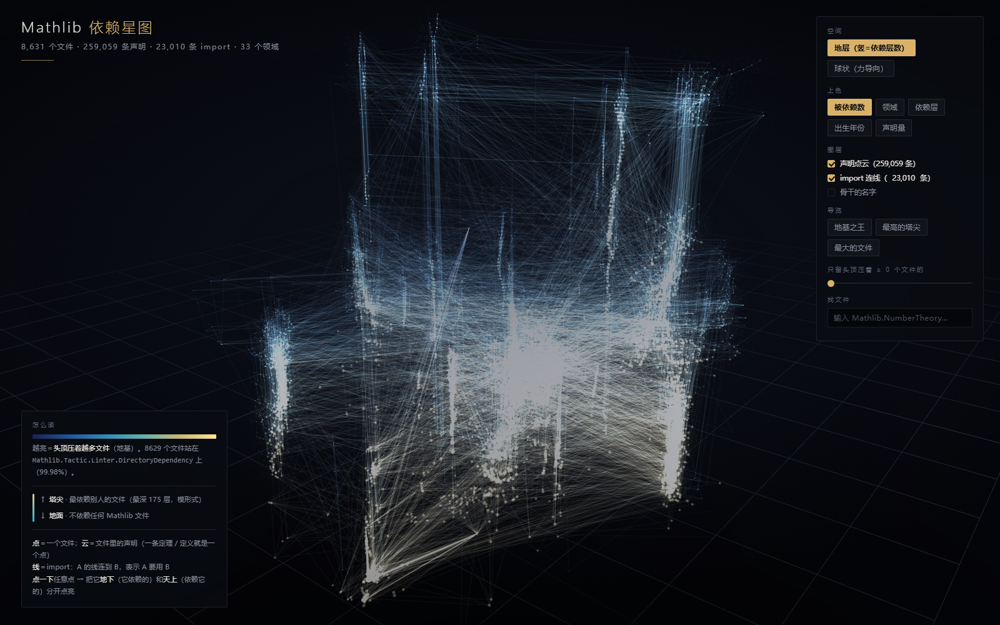

# Mathlib 依赖星图

把 [Mathlib](https://github.com/leanprover-community/mathlib4)（Lean 4 的数学库）画成一张可以走进去的 3D 星图。

**在线看**：https://hobbit18.github.io/mathlib-star-map/ （打开要等几秒——1.1 MB 的数据 + 25.9 万个点）



## 这是什么

| 你看到的 | 它是什么 |
|---|---|
| 一个大点 | 一个 `.lean` 文件（共 **8,631** 个） |
| 围着它的一团点云 | 那个文件里的声明，一条定理／定义算一个点（共 **259,059** 个） |
| 一条线 | 一条 `import`：从「要用的文件」连向「被用的文件」（共 **23,010** 条） |
| 竖着的位置 | 依赖层数：0 = 不依赖任何 Mathlib 文件，175 = 全库最深 |
| 点的大小 | 两样混合：文件自己的分量（声明数）+ 它支撑的分量（多少文件依赖它） |

## 两种空间

- **地层** —— 竖轴就是依赖层数，一眼看出「地基 / 尖塔」结构。
- **球状（力导向）** —— 三维力导向布局，没有任何一个方向被指定含义，只回答「谁和谁近」。

## 操作

| 操作 | 效果 |
|---|---|
| 左键拖 / 滚轮 / 右键拖 | 旋转 / 缩放 / 平移 |
| 悬停 | 浮出文件名、领域、声明数 |
| 点击 | 选中：**脚下**（它依赖的）金色、**头顶**（依赖它的）青色分开点亮 |
| 点两下 | 相机飞过去；再按 `Z` 进微距，`R` 回到全景 |
| `Esc` / `F` | 取消选择 / 飞向选中点 |
| 右上「相机 · 自由漫游」 | `W A S D` 前后左右，`E`/`Q` 升降，按住 `Shift` 加速，拖鼠标转视角，滚轮远近 |
| 右上「导览」 | 一键跳到地基之王／最高塔尖／最大的文件 |
| 右上阈值滑块 | 真的隐藏「头顶压着少于 N 个文件」的点与其连线，拉高只剩骨架 |
| 右上搜索框 | 输 `Mathlib.NumberTheory` 之类，点结果直接飞过去 |

走近的时候有四处只在近处生效的调整（圆的点、按距离缩放的尺寸、远处标签不画、长连线淡出），
保证飞进去看到的是局部结构而不是一片白雾——全景视图完全不受影响。

## 数据是怎么来的

全部从本地克隆的 Mathlib 源码（`git clone --depth 1`，commit `e91b1280`，2026-10-17）**机械解析**出来的：

1. `layout3d.py` —— 解析 `import` 关系，用 networkx 对最大连通分量跑 3D 力导向布局。
2. 依赖层数用最长依赖链长度；「脚下 / 头顶」用可达集合求。
3. `build_demo_data.py` —— 合成 `data.js`（边去重、加环保护）。

复现（需要一份 Mathlib 源码）：

```bash
python layout3d.py          # 3D 力导向坐标（约 20 分钟）
python build_demo_data.py   # 生成 data.js
```

本地打开：直接双击 `index.html` 即可，完全自包含（three.js 已本地化，`file://` 下可用）。

## 几个诚实提醒

- **位置是排出来好看的，不是数据**。只有「点的大小 / 颜色 / 连线」是数据，横竖坐标是力导向布局的结果。
- **点云不展示 259,059 个点**：文件坐标是数据，每个文件周围那团声明点是按「声明数」确定性生成的，形状不代表任何东西。
- **「被指向最多」的是基本词汇**（实数、复数、向量空间、拓扑……），不是某年发现的定理——不要把它读成「数学的基石」。
- 「依赖层数」只算**文件级 `import`**，不算证明内部的引用关系。
- 竖轴高 ≠ 更难，只表示它在 import 链上离地基更远。

## 许可

演示代码随意取用。数据来自 Mathlib（Apache-2.0）。three.js r128（MIT）。
